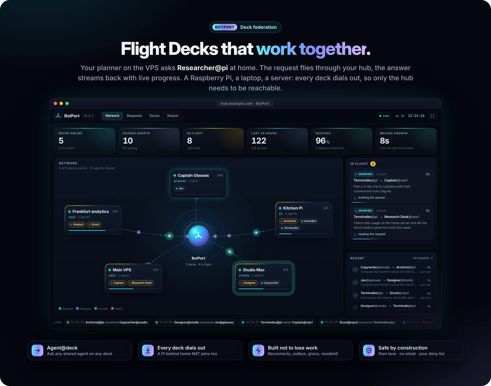
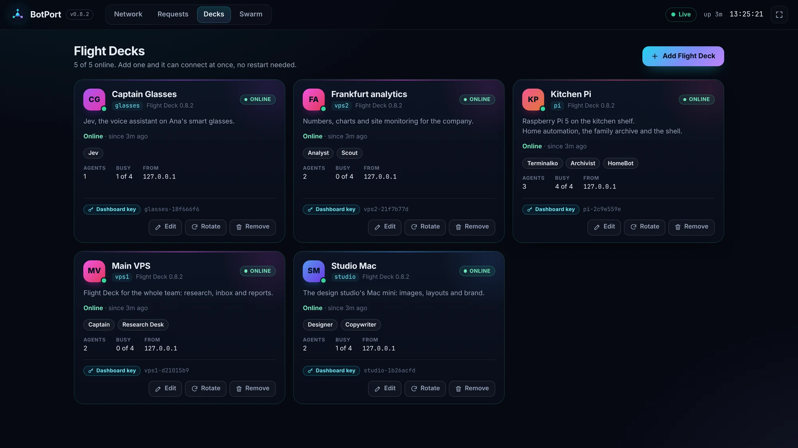
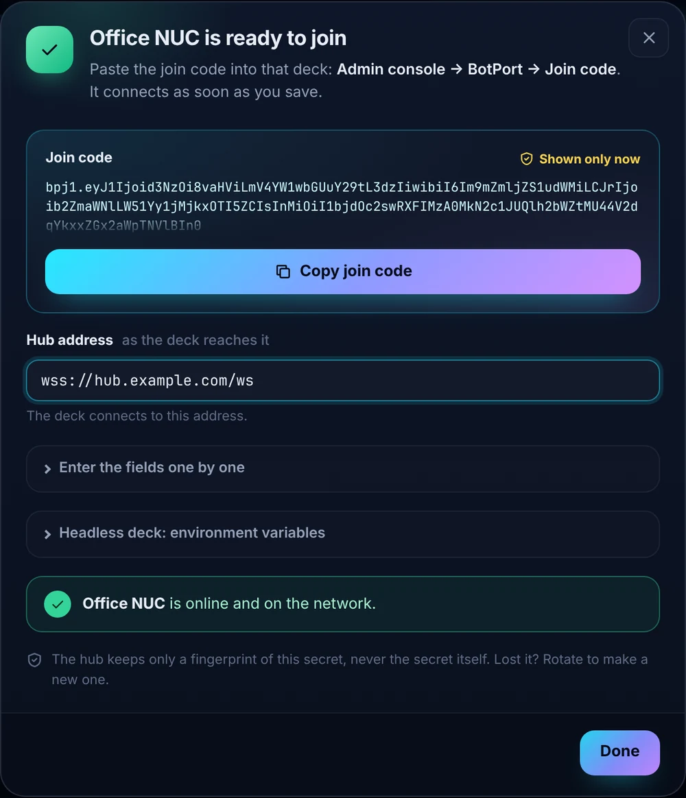
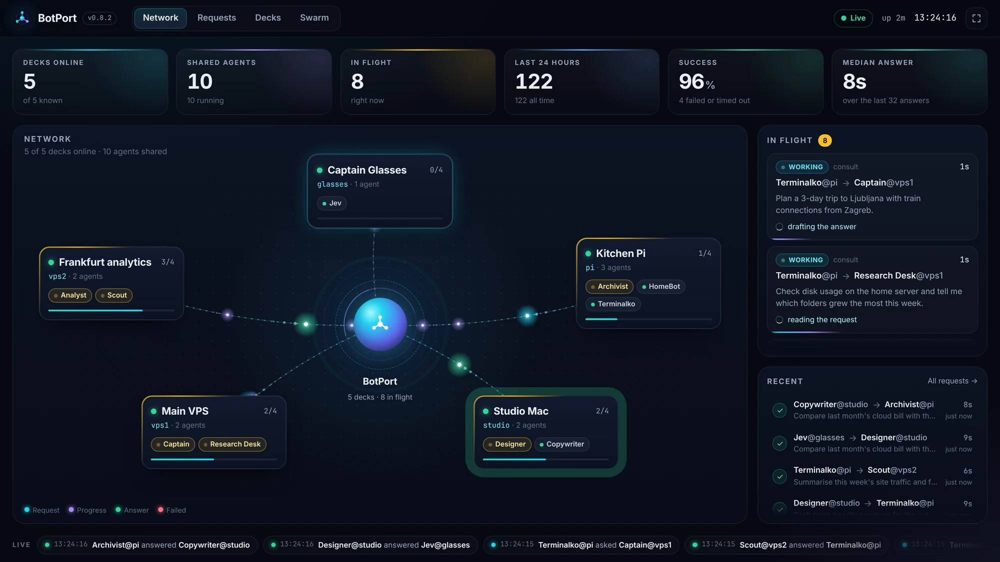
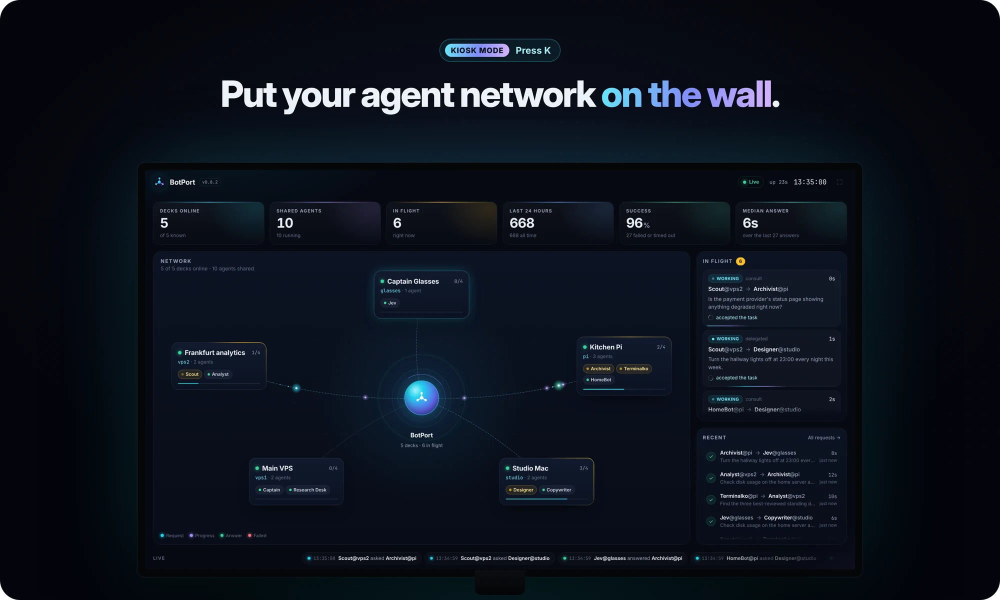

# BotPort, MCP and agent links — decks, agents, Claude and your systems, connected

[← README](../../README.md) · [All guides](README.md)

**On this page:** [BotPort](#botport--flight-decks-that-work-together) · [MCP server](#mcp-server--claude-drives-your-fleet) · [MCP client](#mcp-client--your-agents-use-mcp-servers) · [Agent links](#agent-links--connect-any-system-to-an-agent)

## BotPort — Flight Decks that work together

<p align="center">
  
</p>

Every Flight Deck used to be an island. Now any number of them join one network through **BotPort**, a small hub that is happy on a Raspberry Pi in a tmux pane. Agents address each other as **`Agent@deck`**: your planner on the VPS asks `Researcher@pi` at home, and the answer streams back with live progress, as if both sat on the same deck.

- **Every deck dials out.** A Pi behind home NAT or a laptop joins as easily as a server. Only the hub must be reachable (Tailscale, a tunnel, or its own TLS).
- **Add a deck in a minute, with no restart.** The hub's **Decks** page makes the deck's key and a **join code**. Paste the code into that deck and it's on the network.
- **Everyone can share.** Owners put their own agents on the network from the agent's **⋯**, after a dialog that says plainly what other decks can and can't do with them.
- **Safe by construction.** A request from another deck runs in a lane of its own. It never sends email or triggers Flows, can't fan out to further decks, and obeys your deny list.
- **Built not to lose work.** Decks reconnect, answers wait for a requester that dropped, a worker that dropped gets time to come back, and resubmission is idempotent.

### Add a deck in a minute

<p align="center">
  
</p>

- The new **Decks** page makes a key and a one-time **join code**; Flight Deck's *Admin console → BotPort → Join code* takes it in one paste.
- Rotate or remove a key and it takes effect at once.
- Every deck has a display name and a description that the whole network, and your agents, see.

<p align="center">
  
</p>

### A dashboard for the wall

<p align="center">
  
</p>

- A live map where every request flies from deck to hub to agent and back.
- KPIs, an in-flight rail, a ticker.
- **Kiosk mode** (`K`), a Requests page, a sign-in screen, a phone layout.

<p align="center">
  
</p>

### Sharing and Swarm

- **Sharing** — an admin chooses which agents a deck offers; users can share the agents they own from the agent's menu.
- **BotPort Swarm** — DAG-based multi-agent orchestration across networked instances. Approval gates, retry with fallback, checkpointing, inter-agent file transfer (up to 50 MB), cron scheduling, and a visual dashboard.

**Set it up:** [docs/botport-deployment.md](../botport-deployment.md), from `pip install` on the Pi to the first request between two decks. Press **K** on the hub's dashboard and it becomes a wall display.

## MCP server — Claude drives your fleet

Captain Claw runs as a Model Context Protocol server over stdio — Claude Desktop and other MCP clients can browse sessions, read conversation history, and send prompts to the full agent.

```bash
captain-claw-mcp    # stdio, configure in claude_desktop_config.json
```

**Fleet access for Claude (new in 0.8.0):** Flight Deck itself is an MCP server at `/fd/mcp-server`. Add it to claude.ai or Claude Desktop as a custom connector (OAuth 2.1 — sign in with your Flight Deck account) or to Claude Code with a personal access token, and Claude can list your agents, hand them tasks and read back the results. See [docs/team-deployment.md](../team-deployment.md#connect-claude-to-your-agents-inbound-mcp).

## MCP client — your agents use MCP servers

The other direction: agents in your fleet call into MCP servers. Add a server once in **Flight Deck → Connections → MCP servers** and every agent the allowlist permits gets the tools auto-registered on boot.

- **HTTP transport** — Streamable-HTTP MCP servers, with optional OAuth2 `client_credentials`, captured `Mcp-Session-Id`, and SSE-response parsing.
- **stdio transport** — `command` + `args` + `env` for local MCP servers shipped via `npx` / `uvx` (filesystem, sqlite, github, postgres, etc.). Children are spawned lazily, auto-respawned on death, and torn down with SIGTERM/SIGKILL on close.
- **Per-agent allowlists** — Restrict each server to specific agent slugs. Disallowed agents get HTTP 404 (existence is opaque).
- **Hot reload** — Agents subscribe to `/fd/mcp/agent/events` (SSE) and re-register proxy tools the moment you change a server — no restart needed.
- **Streaming calls** — `POST /fd/mcp/<name>/call_stream` emits `progress` / `result` / `error` SSE frames for UIs that want live indicators while a long-running tool runs.

See **USAGE.md → Flight Deck → Connections → MCP servers** for the full endpoint reference and config schema.

## Agent links — connect any system to an agent

New in 0.8.3. Give an outside system, such as your CRM, shop or monitoring, its own key to one of your agents, and they talk directly.

```
 Your system (CRM, shop, monitor)        Flight Deck                    Agent
 WebSocket   /link/ws          ──▶   cc_link_… key → the link's  ──▶   a 🔗 session of its own
 HTTP  POST  /link/messages    ──▶   queue, events, files               linked_system tool
 signed webhook                ◀──   answers, files, messages     ◀──   (writes on its own)
```

- **Connections → Systems** (in the kiosk too) adds a link to one of your agents. The system gets its own `cc_link_…` key, shown once.
- **Three ways in:** a WebSocket at `/link/ws`; HTTP with `POST /link/messages` (add `?wait=` to get the answer in the same call), `GET /link/events` and `GET /link/files/<id>`; or a webhook Flight Deck signs with HMAC-SHA256. Files go both ways.
- **Or Flight Deck dials out.** A link can name an orchestrator's `wss://` address and the key it issued; Flight Deck keeps the connection open while the agent runs, so an agent behind a home router needs no public address.
- **The agent can write first** with the `linked_system` tool (`list`, `send`), if the link allows it (*the agent can message it*, on by default).
- **Kept apart.** A link's turns run in a session of their own, are never mirrored into your chat, and may write email only if the link's own instructions ask for it. Keys are stored only as a hash; the webhook secret and an outbound link's remote key are sealed. Shared-agent members can't use `linked_system`.
- Webhooks and outbound links go only to public `https://` and `wss://` addresses unless `FD_LINK_PRIVATE_ADDRESSES=1`.
