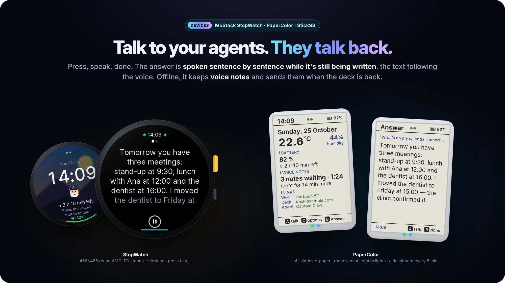
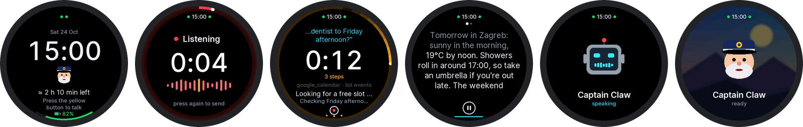
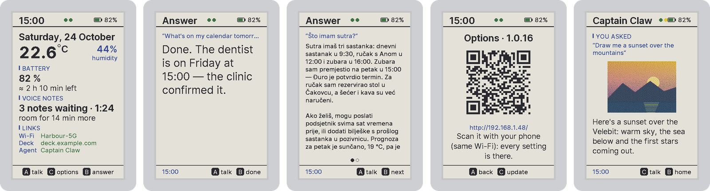

# Devices and channels — your agents, wherever you are

[← README](../../README.md) · [All guides](README.md)

The same agents, the same conversation, from wherever you are.

**On this page:** [Voice devices](#voice-devices) · [Three devices, one firmware](#three-devices-one-firmware) · [Smart glasses](#smart-glasses) · [Chat channels](#chat-channels) · [Agents in your inbox](#agents-in-your-inbox)

## Voice devices

  

Push-to-talk Captain Claw clients on three M5Stack devices:

- the **StopWatch**: a 466×466 round AMOLED with a clock face, touch and vibration;
- the **PaperColor**: a 4" colour e-paper dashboard with two status lights and a room sensor;
- the **StickS3**.

Press, talk, press again, or just stop talking. Flight Deck transcribes it, one of your agents answers, and the device **speaks the answer sentence by sentence while the model is still writing it**, the text following the voice. Since 0.8.2 the voice no longer stops at about 66 seconds: Flight Deck speaks up to about 1,500 characters of an answer, and the device shows the rest.

- Out of Wi-Fi, it keeps **voice notes** and sends them when the deck is back.
- Every question carries the battery, the room's temperature and the local time.
- All three take **signed over-the-air updates** from your own deck.

One firmware tree: `cd firmware/device && pio run -e stopwatch -t upload` (or `-e sticks3`, `-e papercolor_b`). Details in [firmware/device/README.md](../../firmware/device/README.md).

### Three devices, one firmware

| | StickS3 | StopWatch | PaperColor |
|---|---|---|---|
| screen | 240×135 LCD | 466×466 round AMOLED, touch | 4" E Ink Spectra 6, six inks |
| talk | front button | yellow button, or the on-screen record button | A (B build) / C (A build) |
| extras | 18 animated characters | clock face, raise to wake, vibration, background picture, info page | two status lights, room sensor, microSD notes, a dashboard every five minutes |
| build | `pio run -e sticks3` | `pio run -e stopwatch` | `pio run -e papercolor_b` (or `papercolor`) |

- **Signed over-the-air updates** from your own deck (`tools/publish.py`), rolled back if a build can't reach the deck within 90 s.
- **Press to talk, press again — or just stop talking** (2.5 s of quiet sends it), with blips and chimes; the PaperColor records straight from sleep.
- **Answers as they're written** — spoken sentence by sentence while the model is still writing; the lit sentence and the pages follow the voice; pause, replay, stop.
- **Offline voice notes** (ADPCM in flash, or on the PaperColor's microSD) sent as one turn once the deck is back, and a **note-taking mode** for a run of notes.
- **Context with every question** — battery and time left, Wi-Fi, motion, room temperature and humidity, local time, as a `[Context: …]` line the model reads.
- **"Volume up", "beep off"** handled by the deck, never sent to the agent; a turn survives a dropped link.

## Smart glasses

- **Meta Ray-Ban Display HUD** (0.8.0) — a lean Flight Deck at `/hud/` built for a 600×600 display: chat with your agents (approvals, Stop, read-aloud), read their Markdown files, browse the datastore; about 150 KB on the wire, paired with a code you approve at `/hud/pair`. [docs/glasses-hud.md](../glasses-hud.md)

## Chat channels

- **WhatsApp** — a two-way personal-assistant bridge (Meta Cloud API). Every file you send reaches the agent — documents, albums, stickers, voice notes transcribed; agents send pictures, video, audio and documents back and deliver what a turn made once the reply is out. Messages sent while the agent is busy are retried in order, every message gets a reaction, `/new` answers.
- **Telegram** — a native bot with photos, documents, contacts, voice notes, audio and video, and live narration; `/new` starts a fresh session; a team can share one bot, each member relayed to their own agent after admin approval; the owner's own chat continues the main conversation; agents read a read-only **Telegram inbox** and join **groups** through the bot's add-to-group link (0.8.1).
- **One conversation** (0.8.1) — every message records where it came from; the model reads `[via WhatsApp] …`, the kiosk shows *via M5Stack StickS3 (desk)*.
- **Claude** — Flight Deck is an MCP server at `/fd/mcp-server` (OAuth 2.1 for claude.ai and Claude Desktop, a personal access token for Claude Code): `list_agents`, `send_task`, `get_result`, `cancel_task`, `jev_ask`.
- **Slack, Discord, Twitter/X** — message and thread handling, channels and DMs, and an OAuth 2.0 `twitter` tool.

## Agents in your inbox

- **Microsoft 365** — `microsoft_mail`, `microsoft_calendar` and `microsoft_onedrive`, the Outlook twins of the Google tools: per user, owner-only. Outlook mail reads, searches, drafts and files; it **never sends**. Calendar changes that would email attendees need `notify_attendees: true` and a turn where a person asked.
- **Gmail sends — opt-in, audited** — `google_mail` gains `send`, `send_draft`, `update_draft`, `list_drafts`; under Flight Deck every send passes one gate with a per-user policy (off by default), a recipient allowlist, a daily limit, duplicate suppression, an audit table and a bell per send. `FD_GMAIL_SEND=off` is the deck kill switch.
- **Never the same email twice**; **attachments both ways** (`get_attachment` in, `saved/` and `vfs:` files out — 20 files, 25 MB, secrets refused); **filing** (archive, move, labels, categories — never trash); **Google Sheets and Docs edited in place**; an **agentic signature** on every email an agent writes.
- **Topic auto-replies** — off by default: an agent answers inbound Gmail that is *only* about one of your narrow topics, behind a lint, sender authentication, an outbound guard, a second judge, and held cards for anything doubtful. `FD_GMAIL_AUTOREPLY=off` stops it deck-wide.
- **Agents that don't make things up** — mail is human-only in Autonomous Work and automated turns; a **fabrication guard** rejects a claimed send or calendar change with no tool call behind it and asks, at most twice, for a true reply; a garbled reply gets a notice recommending `/new`.
