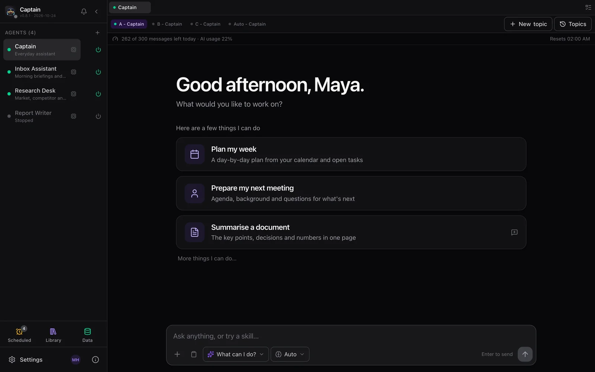
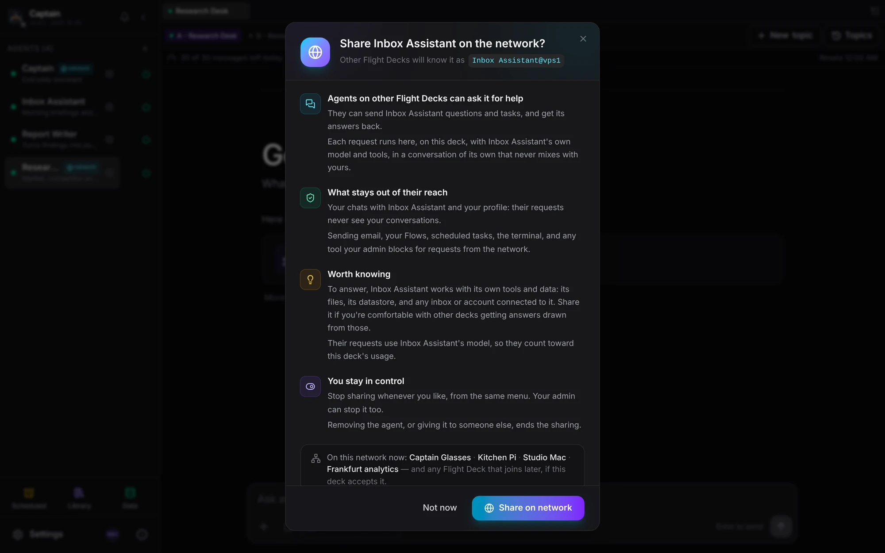

# Flight Deck — the multi-agent command center

[← README](../../README.md) · [All guides](README.md)

A full management dashboard for running teams of AI agents. Spawn, monitor, configure, and coordinate agents from a single UI.

<p align="center">
  
</p>

```bash
flight-deck        # http://0.0.0.0:25080   (alias: captain-claw-fd; add --simple-chat for a kiosk)
```

**On this page:** [Seven orchestration modes](#seven-orchestration-modes) · [Code](#code) · [Plan and Deep mode](#plan-and-deep-mode) · [Orchestrator / DAG mode](#orchestrator--dag-mode) · [Flows and the Observatory](#flows-and-the-observatory) · [Running the fleet](#running-the-fleet) · [The kiosk and simple layout](#the-kiosk-and-simple-layout) · [Activity and audit](#activity-and-audit) · [Running a deck for a team](#running-a-deck-for-a-team) · [Idle agents sleep](#idle-agents-sleep)

## Seven orchestration modes

One agent isn't always the answer — and one orchestration strategy never is. Captain Claw ships **seven distinct modes**, each tuned to a different kind of work.

| | |
|---|---|
| **🛠️ Agent Forge** — describe a goal, an LLM designs the whole team (roles, models, tools, SOPs) | **🏛️ Agent Council** — specialists deliberate across moderated rounds, then vote and synthesize |
| [](../screenshots/agent-forge.png) | [](../screenshots/agent-council.png) |
| **🔀 Basna** — N agents answer the same question *blind*, merged by reliability into one high-confidence result | **🤝 Vatra** — a team collaborates on a shared blackboard, each owning sections, improving over review rounds |
| [](../screenshots/basna.png) | [](../screenshots/vatra.png) |

The fifth mode is **💻 Code** (below) — a plan-gated, independently-reviewed engineering pipeline. The sixth is **Flight Deck** itself — spawn, monitor, and coordinate the whole crew from one dashboard. The seventh, new in 0.8.0, is **🦇 Bat** — the stubborn finisher: checkpointed steps with retries, survives restarts, and stops only when an independent, fail-closed judge says the task is done.

- **Agent Forge** — Describe a business goal in plain text. An LLM designs a specialized team with roles, tools, operating procedures, and a lead coordinator. Review, customize, and spawn the entire team in one click.
- **Agent Council** — Structured multi-agent deliberation. Run brainstorms, debates, reviews, or planning sessions with 2-N agents. Each agent self-scores suitability, chooses actions (answer, challenge, refine, broaden), and responds in moderated rounds. A moderator synthesizes conclusions; all agents vote. Export as markdown minutes.
- **Basna** — A network-source ensemble. Describe a task and a router picks the smallest set of specialist archetypes, spawns them fresh, runs them blind and in parallel, and merges their answers weighted by each archetype's learned reliability (synthesizing only on disagreement). Attach files/images, edit each agent before the run, watch a live progress log, and download generated files. Reliability is learned per-archetype so routing improves over time.
- **Vatra** — A collaborative team on a shared blackboard: a lead splits the work, each agent owns sections, reads what the others wrote, and improves it over review rounds; a reporter assembles the deliverable. Since 0.8.0 workers run until they're done, under an in-turn context governor, reading a rule-built run map.
- **Code** — An agentic coding studio. A router sizes each request; big jobs run plan → your approval → build → three independent reviewers → triage → capped fix loop, each phase a git commit with diff timeline and rollback. Agents query a persistent Code Map instead of re-reading the tree; runs work on VFS folders or your own linked local repos, with per-turn token costs in chat and full process export.
- **Bat** (0.8.0) — A durable "stubborn finisher": plans, runs checkpointed steps with retries, survives restarts, and stops only when an independent judge says the task is done — behind a hard safety floor and a start gate for email, spending and accounts.

## Code

Describe what you want built. A router sizes the job; big work runs **plan → your approval → build → three independent reviewers in parallel → triage → capped fix loop**, every phase a git commit in the folder's own repo. Agents query a persistent **Code Map** (symbols + architecture, git-hash-fresh) instead of re-reading your tree; per-turn **token costs are shown in chat**; the whole process **exports as one auditable Markdown transcript**. Works on fresh folders or **your existing local repos linked in** — on any models you configure, including a cheap implementer with a premium reviewer.

Cursor and Claude Code give you one very good agent that plans, writes, reviews, and tests in a single context. Code splits those roles across **independent agents** — the reviewer never grades its own homework, QA actually runs the tests — and puts **you at the approval gate** before anything is built. Self-hosted, model-agnostic, no lock-in. A complete real run (an RTS game with 185 tests, ~$2.50 on DeepSeek) ships in [`examples/code/`](../../examples/code/). Details in [RELEASE_NOTES_0.7.0.md](../../release-notes/RELEASE_NOTES_0.7.0.md) and [USAGE.md](../../USAGE.md#code--the-agentic-coding-studio-new-in-070).

## Plan and Deep mode

For when "probably right" isn't good enough: a reviewable DAG of verified steps, and frontier-quality answers via multiple rollouts + self-consistency voting + diverse-lens critics. Both are a single **Effort** choice (Standard · Deep · Plan) on the Basna page and work in Basna and Vatra alike; the full story is in [What's New in 0.6.4](whats-new.md#whats-new-in-064).

## Orchestrator / DAG mode

Decompose complex tasks into a dependency graph and execute subtasks in parallel across separate agent sessions.

```
/orchestrate Research startups in 3 countries, analyze founders, create comparison spreadsheet
```

- LLM decomposes the prompt into a task DAG with dependencies
- Parallel execution with configurable worker count
- Shared workspace for inter-task data flow
- Structured output validation (JSON Schema with auto-retry)
- Real-time trace timeline (Gantt-style visualization)
- Headless CLI mode for cron/scripts: `captain-claw-orchestrate`

## Flows and the Observatory

| | |
|---|---|
| **⚙️ Flows** — a deterministic automation DSL (triggers, `gosub`, parallel `spawn`/`join`, `on error`), validated by a parser, not interpreted by an LLM | **🔭 Observatory** — it keeps thinking when you're away: a live, auditable stream of thoughts, dreams, and standing intentions |
| [](../screenshots/flows.png) | [](../screenshots/observatory.png) |

Flows are written as code or in a visual Builder, compiled from plain English, scheduled, and controlled from any channel (`/flow status | pause | resume | stop`). The full language reference is [FLOWS.md](../../FLOWS.md); point your coding assistant at the [flow-builder skill](../../.claude/skills/flow-builder/SKILL.md) to author flows for you.

## Running the fleet

- **Library** — One place for your model tiers (Reasoning / Balanced / Fast / Long context, each with its own provider/model/key/base-URL/context) and the curated archetype gallery (one-click spawn). Agent Forge and Basna both resolve their models from here.
- **Fleet Communication** — Agents discover peers automatically. Consult (synchronous ask) or delegate (asynchronous queue) tasks to specialist agents. Shared workspace and file transfer across the fleet.
- **Director Panel** — Unified overview of all agents. Broadcast messages fleet-wide. Per-agent token/cost analytics, trace timelines, datastore browser, file browser, config editor.
- **Shared Virtual File System** — a host-sandboxed, per-user workspace the whole fleet reads and writes, with per-file authorship.
- **31 ready-made specialists** — an editable archetype library spanning research, writing, engineering (a full coding family: planners, implementers, debugger, reviewers, QA, git operator, cartographer), data, ops, finance, and multimedia.

## The kiosk and simple layout

<p align="center">
   
</p>

The chat-first view your team's non-admins live in is a complete place to work:

- a **getting-started guide** and one-click **"What can I do?" skill cards**;
- a **File library** and a **Data library** that summarise everything the agents keep;
- **Shared folders** (0.8.3): the shared VFS as a library — recent files, your folders, agent runs, what's shared with you, linked folders, and **Google Drive** and **OneDrive** folders mounted read-only — with preview, edit, rename, drag-and-drop upload, search and a `vfs:` address to hand your agents;
- **fullscreen** on the File library, the Data library and Shared folders (0.8.3);
- **Scheduled tasks** that deliver to chat, email or Telegram;
- one **timeline** per agent with named topics, and a **reasoning-effort** picker;
- a **⋯** menu per agent for its model, instructions and settings, which also **shares it on the network** and shows its **Activity**;
- **⌘/Ctrl+Enter** to queue a message on the lane's queue, switched to Auto (0.8.3); Enter still sends.

Admins get an **Admin console**, invitations by email, a waitlist that answers applicants, branding and daily plan limits.

**Simple layout and kiosk** (0.8.0, grown up in 0.8.1) — a chat-first view (Cmd/Ctrl+\): agents with a busy pill and power switch on the left, one timeline per agent with named topics in the middle, a phone layout of its own. An admin picks who is locked into it (everyone, selected users, new users). Kiosk users get a getting-started guide, "What can I do?" skill cards, a File library and a Data library, Scheduled tasks, a reasoning-effort picker, a ⋯ menu per agent, an archetype picker for new agents, their own Connections and a clean sign-out.

[](../team-deployment.md)

The chat-first **simple layout** (Cmd/Ctrl+\) with agents, chat, files and datastore — `flight-deck --simple-chat` turns it into a **kiosk** for non-admins. Before a second person logs in, set `FD_AUTH_ENABLED`, a fixed `FD_JWT_SECRET` and `FD_PUBLIC_URL` / `FD_ALLOWED_HOSTS`; the first account becomes the admin, **Admin → Users** adds the rest, and **Library → Publish to team** gives them models without pasting keys. The full checklist is [docs/team-deployment.md](../team-deployment.md).

## Activity and audit

New in 0.8.3: the **tool-call register** records every tool call every agent on the deck makes — the agent, the time, the tool, its parameters with secrets masked, what started it, and how it ended (`ok`, `error`, `blocked`, `timeout`, `aborted`, `interrupted`). Calls are recorded before the safety checks, so refused calls show up too.

- **Activity** — in the kiosk's Settings and on each agent's **⋯**: your own agents' calls.
- **Admin console → Audit** — every call on the deck, an integrity check of the chain, and the retention (90 days by default, 7 to 3,650).
- CSV and JSON-lines export.
- **Tamper-evident**: rows are append-only and HMAC-chained, and gaps show. Someone with access to the host *and* the deck's key could still rebuild the chain, and tools a model provider runs on its own side aren't recorded.
- A shared agent's owner sees members' calls without their parameters or errors.
- Agents read their own record with the `activity` tool; see [Inside an agent](agents.md).

## Running a deck for a team

- **Admin console** (0.8.1) — `<deck>/console/<page>`: an overview with a setup checklist, model tier sets and team keys, archetypes, deck-wide connections, users with invitations and the waitlist, usage and daily plan limits, branding and sign-up settings. Admins start there.
- **Multi-user Auth & teams** — JWT authentication, admin dashboard, rate limiting, and quotas; owner-scoped routes, per-user Google/Microsoft, team tier sets, shared agents, and a kiosk mode (0.8.0); invitations by email, a waitlist, password changes, branding and daily plan limits per user (0.8.1).
- **Connections** — One tab per service: Google, Microsoft, ChatGPT, Antigravity, MCP Servers, WhatsApp, Telegram, Deep memory, Jev — each person connects their own accounts, and an agent only ever gets its owner's token. *Agent access for Claude (MCP)* issues the personal access tokens the HUD and the devices use too.
- **MCP Connections** — Add Model Context Protocol servers (HTTP or stdio) once and every entitled agent in the fleet picks up their tools — no per-agent config. Phase 2 adds stdio transport for `npx`/`uvx`-shipped servers, per-agent allowlists, hot tool-list reload over SSE, and streaming tool calls.
- **Branding** — the deck's name and logo on the sign-in page and, since 0.8.3, in the browser tab.

The step-by-step checklist is [docs/team-deployment.md](../team-deployment.md).

## Idle agents sleep

New in 0.8.3, off by default. **Admin console → Settings → Agents → Put idle agents to sleep** stops agents that have been idle for a while (10 minutes to a week) to free memory.

- A sleeping agent wakes **five minutes before** its scheduled tasks and cron jobs, and **when something needs it**: a chat, a channel message, a device, a link, a member, another agent, a Flow or an auto-reply.
- The kiosk shows *Asleep*, process cards an `asleep` badge, and the Processes page counts sleeping agents apart.
- Never put to sleep: run workers, Iskra beings, agents with a Telegram, Slack or Discord bot of their own, an agent with a run in flight, and Docker agents.
- `FD_AGENT_IDLE_STOP_S` (seconds) overrides the admin setting.
